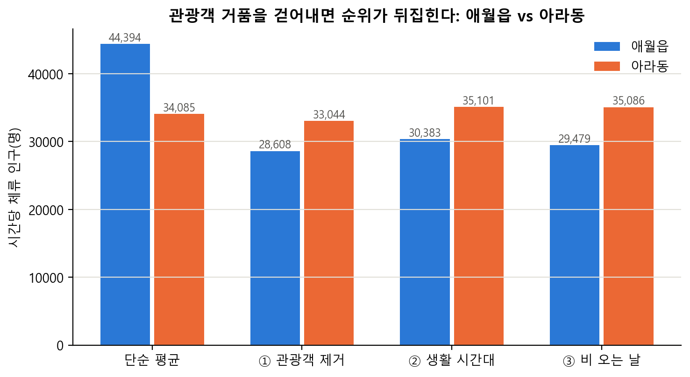
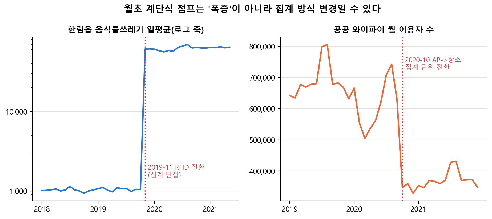
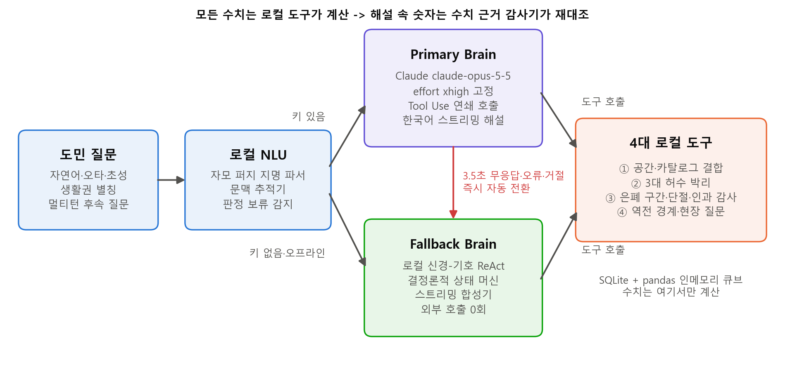
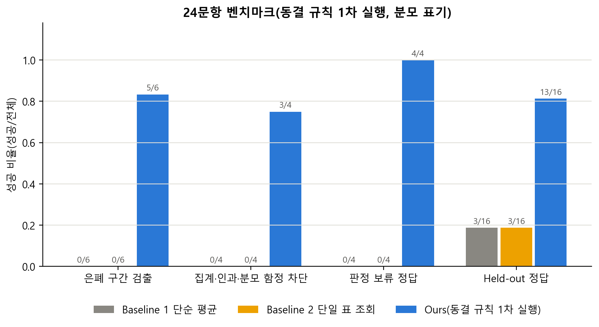

# AI Agent 기획서: 제주의 두 얼굴 (15쪽 완성본)

> 공식 기획서 5대 목차 매핑: 1~2쪽 구현목표 / 3~6쪽 서비스 제안 / 7~10쪽 Agent 개발 구성 / 11~12쪽 데이터 활용 계획 / 13~15쪽 개발·탑재 계획 및 검증 결과

> 이 원고의 모든 수치는 scripts/generate_proposal_deck.py 가 도구를 실제로 실행하고 벤치마크·퍼징 리포트를 읽어 자동으로 채웠습니다.

## 1쪽 · [1. 구현목표] 제주의 두 얼굴: 관광객·기상·평균의 3대 허수를 벗기는 도민 데이터 변호사

**핵심 메시지** 제주 공공데이터의 '평균'은 관광객·낮 시간·맑은 날이 섞인 착시입니다. 이 에이전트는 그 허수를 벗겨 도민 실생활 결론과 민원 근거를 1분 안에 만듭니다.

**핵심 수치** 21 / 24(24문항 정답(동결 규칙 1차)) · 50 / 50(가혹 입력 퍼징 통과) · 40 / 40(Claude·로컬 판정 일치(40문항)) · 4 / 24(단순 평균 방식 정답)

- 60초 요약: 질문 한 줄 -> 4대 로컬 도구 실행 -> 3단 대조 대시보드 + 1쪽 증거 카드 + 현장 확인 질문 1개
- 검증(동결 규칙 1차 실행): 24문항 중 21 / 24 정답, 단순 평균 방식은 4 / 24
- 무결점: 50문항 퍼징 50 / 50 통과(런타임 오류 0건), 실제 Claude 경로 40문항 판정 40 / 40 로컬과 일치
- 하이브리드: Claude claude-opus-5-5(effort xhigh) + 키 없이도 100% 동작하는 로컬 신경-기호 엔진
- 정직성: 이 기획서의 분석 수치는 공식 예시데이터 스키마를 보존한 시드 고정 합성(시연용) 데이터 기준이며, 원자료를 넣으면 같은 절차로 재계산됩니다(모든 행에 출처 태그)

## 2쪽 · [1. 구현목표] 분석 주제와 목표: 평균이 숨기는 도민의 하루

**핵심 메시지** 같은 동네도 관광객·시간대·날씨를 빼면 다른 얼굴이 드러납니다. 목표는 '이사·출퇴근·외출 결정'과 '통계 주장·민원 검증'을 도민 스스로 하게 하는 것입니다.

**핵심 수치** 3대 허수(관광객·시간대·악천후) · +3 함정(집계 단절·미측정 인과·분모) · 1개(답변마다 현장 확인 질문)

- 허수 ① 관광객 거품: 도외 거주자 체류·관광 소비가 '활기'를 부풀림
- 허수 ② 주간 쏠림·야간 공동화: 낮 평균은 밤 9시 이후 생활을 대변하지 못함
- 허수 ③ 악천후 나비효과: 비 오는 날 퇴근길 정류소 혼잡은 연평균에 묻힘
- 추가 함정: 월초 계단식 집계 단절, 원자료 컬럼에 없는 원인 단정, 일부 행만 계산된 평균(분모 함정)
- 성과 지표: 평균 착시 오판 0건, 은폐 구간 검출률, 인과 과장 차단률, 정상 주장 오경보 0건, 판정 보류 정확도

## 3쪽 · [2. 서비스 제안] 데이터 활용 개요: 4대 축을 공간 키로 묶는다

**핵심 메시지** 공식 예시데이터 70개 시트 전부를 기준 테이블로 적재하고, 같은 컬럼·코드값으로 확장한 4대 축을 행정동-법정동-정류소-관측소 키로 결합합니다.

| 축 | 로컬 테이블(행 수) | 공식 시트·데이터허브 출처 |
|---|---|---|
| ① 유동·생활인구/소비 | floating_pop_hourly(379,776), card_time_monthly(99,624) | 4-11 내국인 유동인구(읍면동)_v02 / #753, 1-14 카드 이용 현황(시간대)_v02 |
| ② 대중교통·이동 | bus_stop_hourly(503,424), bus_service_hourly(912) | 3-04 버스 정류소별 이용 현황 / #725·#1249 |
| ③ 기상·환경 | weather_daily(920), food_waste_monthly(1,763), ev_charging_wait(2,447) | 5-02 일일 날씨 정보 / #756, 5-05 음식물쓰레기 / #515, #136 전기차 충전 |
| ④ 메타·집계변경 이력 | datahub_catalog(1,259), aggregation_changes, column_registry | 제주데이터허브 데이터목록_20261105.xlsx 전량 |

- 전체 91개 테이블 1,090,386행, 모든 행에 source_type·dataset_id·reference_date 출처 태그
- ①~③ 축 분석 테이블은 공식 컬럼·코드값을 그대로 쓴 시드 고정 합성(시연용) 데이터(source_type=synthetic_seed), 사용자 제공 공개 통계 사례는 calibrated_reference 로 구분 표기
- 원자료 CSV를 data/raw 에 넣으면 컬럼 서명을 인식해 합성 테이블 대신 최우선 적재(official_raw)

## 4쪽 · [2. 서비스 제안] 핵심 기능: 3개 작업 공간

**핵심 메시지** 도민의 생활 질문, 시민의 반박 근거, 담당자의 새 파일 점검을 한 화면에서 처리합니다.

**핵심 수치** 3개(작업 공간) · 12개(원클릭 시연 시나리오) · 3구획(모든 답변의 고정 형식)

- 모드 1 제주의 두 얼굴(실생활 교차검증): 이사·출퇴근·외출 비교, 귀가 시각·우천 경계 계산
- 모드 2 평균의 거짓말, 도민의 증거(시민 데이터 변호사): 기사·주장·민원 문장을 감사하고 중립 교정문 작성
- 모드 3 새 제주 CSV 실시간 감사기: 아무 CSV + 주장 -> 인코딩 복구, 수치 재계산, 월경계 단절, 인과 과장 교정
- 공통 출력: [원자료로 확인된 수치 사실] / [교란 제거 후 역전 구간] / [한계 및 현장 확인 질문 1개]
- 원클릭 시연 버튼 12개(작업 공간별 6개), 후속 질문 버튼 3개, 1쪽 증거 카드 내려받기

## 5쪽 · [2. 서비스 제안] 도민 편의성 + 분석 사례 ①: 관광객 거품 역전

**핵심 메시지** (합성 시연 데이터 기준) 단순 평균은 애월읍 44,394명 > 아라동 34,085명이지만, 도외 거주자를 빼면 애월읍 28,608명 < 아라동 33,044명으로 뒤집힙니다.

- 애월읍 체류 인구 중 도외 거주자 비중 35.6%, 아라동 3.0%
- 오타·초성·별칭(노형똥, ㅅㅈㅈ, 신제주, 삼화지구)과 '그럼 8시 이후는?' 같은 후속 질문을 그대로 이해
- 표본이 5일 미만이면 [요일·시각 -> 평일/주말 구간 -> 지역 전체] 순으로 조건을 넓히고 그 사실을 알림

## 6쪽 · [2. 서비스 제안] 분석 사례 ②: 집계 단절·은폐 구간·우천 경계

**핵심 메시지** 한림읍 음식물쓰레기 일평균 1,045.23 -> 61,346.42(58.69배, 사용자 제공 공개 통계 사례로 보정한 표본)은 2019년 11월 RFID 전환 시점과 일치하는 집계 단절입니다. '관광객 때문'은 측정 컬럼이 없어 단정할 수 없습니다.

- 오일장 정류소: 전체 평균 시간당 28.5명이지만 장날(2·7일) 09~13시에는 같은 시각 평소의 2.24배
- 아라동 vs 삼화지구 귀가: 맑은 날 경계 20시, 비 오는 날 경계 18시로 앞당겨짐
- 교정문 예: '한림읍 배출량이 변했다(원인 미확인, 관광객 영향은 추가 자료로 검증 필요)'

## 7쪽 · [3. Agent 개발 구성] 참여자 역할·목표·Workflow

**핵심 메시지** 에이전트는 4단계 ReAct 흐름을 매번 같은 순서로 실행하고, 각 단계 결과를 화면 상태창에 공개합니다.

**핵심 수치** Step 1~4(매번 같은 순서의 ReAct) · 4개(로컬 교차검증 도구) · 271 ms(로컬 평균 응답)

| 참여자 | 목표 | 에이전트가 하는 일 |
|---|---|---|
| 도민 | 이사·출퇴근·외출 결정 | 생활권 별칭 해석, 교란 제거 비교, 귀가 경계·방문 시각 제시 |
| 시민·기자 | 주장·민원 검증 | 은폐 구간·집계 단절·미측정 인과·분모 함정 감사, 중립 교정문 |
| 센터 담당자 | 새 데이터 점검 | CSV 인코딩 복구, 공식 시트 스키마 대조, 수치 재계산 |

- Step 1 의도·지명 해석 -> Step 2 데이터셋·공간 키 결합 -> Step 3 3대 허수 박리 -> Step 4 은폐 구간·역전 경계
- 모든 단계는 같은 파이썬 도구를 쓰므로 Claude 경로와 로컬 경로의 수치가 항상 같음

## 8쪽 · [3. Agent 개발 구성] Hybrid Dual-Brain: Claude API + 로컬 무결점 엔진

**핵심 메시지** 키가 있으면 Claude claude-opus-5-5(effort xhigh)가 해석·도구 연쇄·해설을 맡고, 3.5초 무응답·인증/네트워크 오류·429·거절이면 화면 오류 없이 로컬 엔진이 즉시 이어받습니다.

- 숫자는 로컬 도구만 계산: Claude 에게는 도구 결과의 숫자만 인용하게 하고, 해설 속 숫자는 수치 근거 감사기가 재대조해 근거 없는 숫자를 화면에 표시
- 비용 상한·호출 제한 없음(모델·추론 강도 고정). 대화 이력은 추가만 해 사고 블록 무결성 유지
- 장애 시험 6종 통과: 잘못된 키·네트워크 차단·첫 응답 지연·거절·서버 과부하는 로컬 자동 전환, 도구 예외는 나머지 도구로 답변

## 9쪽 · [3. Agent 개발 구성] 4대 Tool 명세(Claude tools JSON Schema 겸용)

**핵심 메시지** 같은 함수가 로컬 엔진과 Claude Tool Use 에 동시에 노출됩니다.

**핵심 수치** 49 ms(3대 허수 박리 1회) · 43 ms(은폐 구간 발굴 1회) · 36 ms(역전 경계 계산 1회)

| 도구 | 입력 | 핵심 처리 | 출력 |
|---|---|---|---|
| resolve_spatial_catalog | areas, topic | 별칭·오타 해석, 2~4종 데이터셋 선택, 행정동-법정동-정류소-관측소 결합 | 공간 단위, 출처, 공식 시트 컬럼 일치 |
| decompose_confounders | areas, 시간대, 날씨, 요일 | 단순 평균 -> 관광객 제거 -> 생활 시간대 -> 우천 4단 순위 | 역전 여부, 단계별 수치 |
| excavate_masked_slice | areas, claim | 요일x시간x날씨/장날 조각 배율, 월초 단절, 인과 컬럼 대조 | 은폐 구간, 단절, 교정문 |
| simulate_reversal_boundary | areas, 변수 | 귀가·방문 시각, 허용 대기, 우천을 움직여 경계 계산 | 경계, 증거 카드, 질문 1개+후속 3개 |

## 10쪽 · [3. Agent 개발 구성] 자율 수행 범위와 판정 보류

**핵심 메시지** 에이전트는 근거가 있을 때만 결론을 내고, 컬럼·기간이 없으면 억지 추론 대신 판정을 보류합니다.

**핵심 수치** 4 / 4(판정 보류 정답) · 6종(장애 시험 통과) · 0회(다른 모델로 넘김)

- 자율 수행: 지명 교정, 비교 상대 자동 선택, 조건 완화, 도구 순서 결정, 증거 카드·후속 질문 생성
- 판정 보류: 집값·소음·치안·학군 등 측정 컬럼 없음, 보유 기간 밖 시점(예: 작년 겨울) -> 보류 + 현장 확인 질문
- 벤치마크 판정 보류 문항 4 / 4 정답(기준선 0 / 4)
- Claude 가 안전 정책상 거절(refusal)하면 다른 모델로 넘기지 않고 로컬 엔진이 같은 도구로 답변(모의 거절 시험 통과)

## 11쪽 · [4. 데이터 활용 계획] 필수 데이터명·출처·활용 항목

**핵심 메시지** 대회 제공 엑셀 2종을 전부 해독해 실제 컬럼명·코드 표기를 그대로 쓰고, 데이터허브 목록 번호로 출처를 연결합니다.

**핵심 수치** 70개(예시 시트 전량 적재) · 1,259건(데이터허브 목록 전량) · 11/11(유동인구 컬럼 일치)

| 대회 제공 파일 | 활용 방식 | 핵심 항목 |
|---|---|---|
| 제주데이터허브 데이터목록_20261105.xlsx | 1,259건 전량 적재 + 주제별 데이터셋 탐색 | #753 유동인구, #725/#1249 정류소 이용, #756 기상, #515 음식물, #749/#742 와이파이, #136 전기차 |
| 제주빅데이터센터_예시데이터 및 컬럼확인용.xlsx | 70개 시트 전부 기준 테이블(bdc_*) 적재 | resd(제주/그외), resd·work·visit_pop_cnt, get_on_off_type, user_category, daily_rainfall 등 |

- 분석 테이블 컬럼은 공식 시트와 1:1 일치(유동인구 11/11, 정류소 9/9, 기상 14/14)
- 이용조건: DAKER 제공 파일은 외부 배포 금지 -> 제출 ZIP 기본 모드에서 원본 엑셀 제외, 해독 결과만 포함

## 12쪽 · [4. 데이터 활용 계획] 수집·전처리·교란 박리 방법

**핵심 메시지** 현장 데이터의 함정을 자가 치유 로더가 먼저 고칩니다.

**핵심 수치** 5단계(인코딩 자동 판별) · 4종(구분자 자동 인식) · 20261120(고정 시드)

- 인코딩 utf-8-sig -> cp949 -> euc-kr -> utf-8 -> latin1 자동 판별, 구분자(, 탭 ; |) 자동 인식
- 마스킹('*','**','***')은 0이 아니라 결측, 'NULL' 문자열 정리, 천 단위 콤마·float32 잡음 정리
- 엑셀 날짜 자동변환 오염 복원('02월 01일' -> 노선 '2-1'), NBSP 섞인 권역명·요일/성별 표기 혼재 정규화
- 합성 확장은 시드 20261120 고정, source_type 으로 synthetic_seed / calibrated_reference / official_example 를 구분 표기
- API Key: Anthropic·제주데이터허브 키는 .env 에만, 데이터허브 키는 어떤 제출 모드에서도 제외

## 13쪽 · [5. 개발·탑재 계획] 구현 범위와 UI 화면 구성 + 60초 시연 대본

**핵심 메시지** Streamlit 한 화면: 상단 엔진 배지, 사이드바 브레인 컨트롤러, 3개 탭, 대화 + 3단 대조 대시보드.

**핵심 수치** 60초(시연 대본) · 3단(대조 대시보드) · 1장(증거 카드(HTML))

- 0~10초: 사이드바에서 키 없이 '100% 로컬 자립 모드' 배지 확인, 강제 오프라인 스위치 소개
- 10~25초: '관광객 거품' 버튼 -> 애월읍 vs 아라동 4단 순위 차트에서 역전 확인
- 25~40초: '그럼 퇴근 시간을 8시 이후로 바꾸면?' 입력 -> 문맥 계승, 귀가 경계 20시
- 40~50초: 변호사 탭 '집계 단절' -> 한림읍 58.69배는 RFID 전환 단절, 관광객 인과는 판정 불가
- 50~60초: CSV 감사 탭에서 CP949 표본 올리기 -> 수치 재계산 일치, 증거 카드 내려받기

## 14쪽 · [5. 개발·탑재 계획] 센터 PC 호환성과 외부 의존성 Zero-Risk

**핵심 메시지** 최소사양(i7-8700 / RAM 32GB / GTX 1060 3GB)에서 GPU 없이 CPU·RAM 인메모리 인덱스로 동작합니다.

**핵심 수치** 209 MB(프로세스 메모리) · 6.8초(DB 최초 구축) · GPU 0(CPU 만 사용) · 1개(선택)(외부 의존 API)

- 벤치마크 실행 중 프로세스 메모리(RSS) 209.1 MB, 로컬 평균 응답 270.7 ms
- DB 는 첫 실행 때 자동 구축(검증 PC 약 7초), 이후 메모리 큐브 재사용
- 외부 의존: Claude API 1개(선택). 없거나 막혀도 같은 결과 화면을 로컬 엔진이 생성
- 제출 ZIP: local-only(모든 키 제거, 기본) / with-eval-key(평가용 Anthropic 키만 유지) 두 모드
- 단 하나의 원시 오류 화면도 노출하지 않음: 예외는 로컬 로그에만 기록하고 로컬 답변으로 대체

## 15쪽 · [5. 개발·탑재 계획] 검증 결과: 정직한 벤치마크와 무결점 스트레스 테스트

**핵심 메시지** 동결 규칙 1차 실행: Dev 8 / 8, Held-out Test 13 / 16. 실패 3건을 공개하고 버그 2건을 고친 사후 재실행은 Test 15 / 16(held-out 성능으로 주장하지 않음).

| 지표(성공/전체) | Baseline 1 | Baseline 2 | Ours 1차 |
|---|---|---|---|
| 평균 착시 오판(낮을수록 좋음) | 5 / 5 | 5 / 5 | 0 / 5 |
| 은폐 구간 검출 | 0 / 6 | 0 / 6 | 5 / 6 |
| 집계·인과·분모 함정 차단 | 0 / 4 | 0 / 4 | 3 / 4 |
| 정상 주장 오경보(낮을수록 좋음) | 1 / 5 | 1 / 5 | 1 / 5 |
| 판정 보류 정답 | 0 / 4 | 0 / 4 | 4 / 4 |

- 퍼징 50 / 50, 질문 5,207개 실행 오류 0건, Claude 40문항 판정 로컬 일치 40 / 40
- 말투 견고성(다른 모델이 만든 평가용 2,548문항): 해석 일치 75.7% -> 84.0%, 사후 87.3%
- 대규모 시험 평가용 해석 일치: 조합 2,550만 74.2% -> 86.4%, 다양성 7,101만 64.7% -> 93.0%, 1억 90.6% -> 92.3%, 새 말투 6,001만 89.9% -> 92.7%, 해석기 예외 0건
- 남은 한계: 토요일 혼잡(T10) 미탐, 분석 데이터 다수가 합성(원자료 적재 시 재계산)

